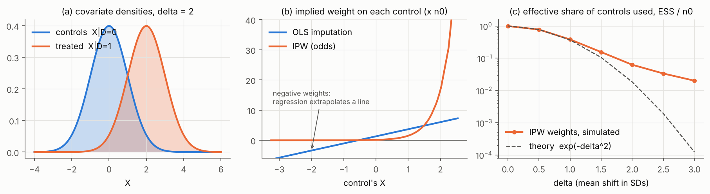
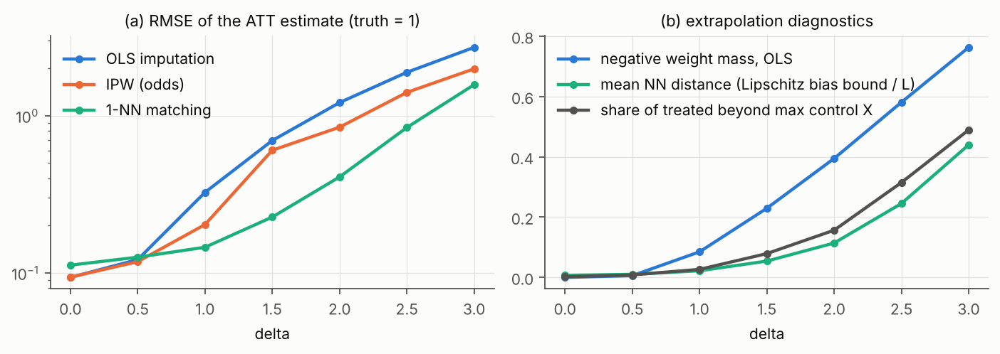
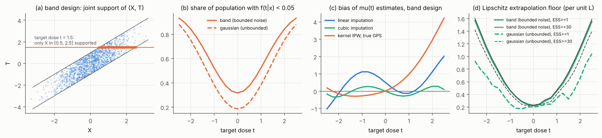
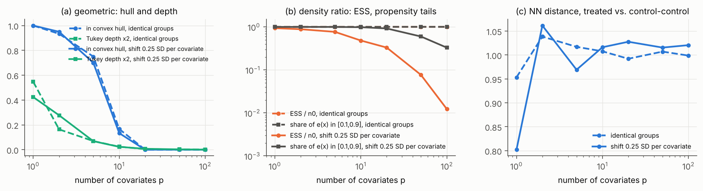
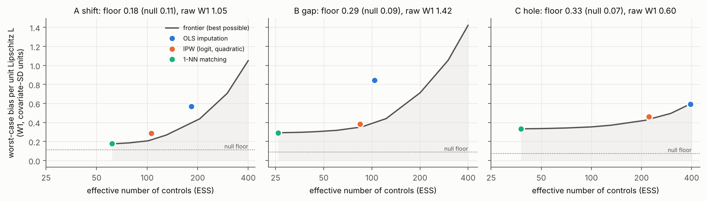
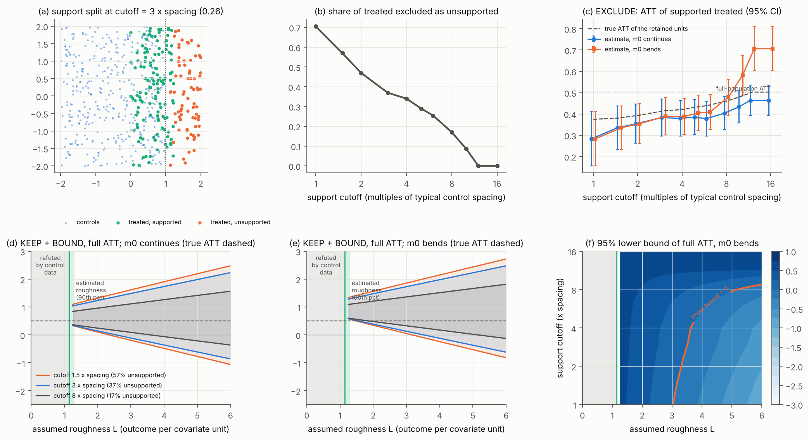

# Overlap and extrapolation risk in causal inference: an investigation and research plan

*Stage 1 report. Scope: theory, a critical survey, ideas from other parts of mathematics, small numerical illustrations, and a ranked research plan. No software package is built at this stage. The scripts in `scripts/` produce every number and figure cited here, and their outputs are in `outputs/`.*

---

## 0. Summary

**The problem in one paragraph.** Every estimator of a causal effect under "selection on observables" fills in outcomes nobody observed. Imputation (outcome-model) estimators do it by predicting the missing potential outcome from a fitted model. Re-weighting estimators do it by letting comparison units stand in for the target units. Both are safe only where the comparison data actually sit, which is what *overlap* (positivity) guarantees. When overlap fails, imputation becomes extrapolation of a functional form, and re-weighting becomes extrapolation of a few units' outcomes, or else a silent change of the estimand. Existing diagnostics each capture one part of this. Propensity-score plots and weight summaries capture the variance side. The convex hull captures a crude form of the support side. Bias-aware inference captures the bias side, but only after an outcome model and a smoothness constant have been chosen. None is at once *target-specific* (about the estimand actually reported), *graded* (a degree of risk) and *estimator-agnostic*.

**Main findings.**

1. **One lens for both strategies.** Regression imputation, IPW, matching and balancing weights are all, for a fixed design, *linear in the comparison units' outcomes*: \(\hat\tau = \bar Y_{\text{target}} - \sum_j w_j Y_j\). The conditional error then splits exactly into a bias term \(\int m_0\, d(P^\* - Q_w)\) and a noise term \(\sum_j w_j\varepsilon_j\). Overlap is the question of whether *some* weights make both small. Regression fails by putting negative weight on some units (extrapolating a line). IPW fails by putting enormous weight on a few units (extrapolating their outcomes). See Illustration 1.
2. **Bias and variance have natural, computable bounds.** If \(m_0\) is \(L\)-Lipschitz, the worst-case bias of any such estimator is \(L\cdot W_1(P^\*, Q_w)\), by Kantorovich–Rubinstein duality. For signed weights the bound is the Kantorovich–Rubinstein norm. The noise variance is \(\sigma^2/\mathrm{ESS}(w)\). For the ideal IPW weights, \(\mathrm{ESS}/n_0 \to 1/(1+\chi^2(P^\*\Vert P_0))\).
3. **Proposed metric: the *overlap frontier*.** Define \(B(k) = \min\{W_1(P^\*,Q_w): w\ge 0,\ \sum w=1,\ \mathrm{ESS}(w)\ge k\}\). This curve is target-specific (change \(P^\*\) to change the estimand), graded, and measured in interpretable units (bias per unit of outcome roughness, against effective sample size). It needs no outcome data, and it bounds every linear estimator at once. Its left end, the *extrapolation floor*, is zero in the population if and only if the target lies inside the comparison support. A solved transport problem computes it exactly. It extends directly to multi-valued and continuous treatments and to policy (shift) estimands. See Illustrations 3(d) and 5.
4. **Geometric diagnostics mislead in both directions.** The convex hull and Tukey depth miss holes in the support. In Illustration 4, treated units sitting inside an empty hole are rated *deeper* than well-supported ones. In high dimension the same diagnostics declare "extrapolation" even when treated and control groups are *identical* (Illustration 2). Local measures (nearest-neighbour or union-of-balls coverage, conformal outlier p-values, persistent homology in low dimension) detect holes correctly. But with raw Euclidean distance they are in turn blind to diffuse high-dimensional shifts that the effective sample size catches (Illustration 2). The choice of metric is therefore the crux.
5. **Continuous treatments are where the problem is most neglected.** For the dose-response \(\mu(t)=E[Y(t)]\), positivity requires the whole vertical slice \(\{t\}\times\mathrm{supp}(X)\) to lie in the joint support of \((T,X)\). In a design where \(T\) is simply \(X\) plus bounded noise, strict positivity fails at *every* dose, even though \(T\) ranges over the whole real line. GPS-weighting then does not blow up: it silently estimates the effect for a different population (Illustration 3). Shift-type estimands need only local support, and their overlap can be graded directly.

**Recommended direction (ranked first in §5; revised after discussion).** A **hybrid sensitivity analysis** (§4.6).

1. Split the target units into *supported* and *unsupported* sets by their distance to the comparison data, at a range of cutoffs.
2. Present results as **curves**:
   - the effect on the supported subpopulation (unsupported units excluded), against the cutoff;
   - the full-population effect, with worst-case Lipschitz bounds applied *only* to the unsupported units, against the cutoff and the assumed outcome roughness \(L\).
3. Supply an **empirical estimate of the roughness** from comparison-arm outcomes only.

The data can rule out any roughness below that estimate. They cannot bound it from above in the unsupported region, so results are shown at multiples of it, with a breakdown value.

The overlap frontier (§4.2) is the outcome-free design-stage map that comes before this analysis. A conformal support test (§4.5) provides a finite-sample version of the supported/unsupported split.

---

## 1. Starting from potential outcomes

### 1.1 Set-up and estimands

Units \(i=1,\dots,n\) have covariates \(X_i\in\mathcal X\subseteq\mathbb R^p\), a treatment \(T_i\in\mathcal T\), and potential outcomes \(\{Y_i(t): t\in\mathcal T\}\). We observe \(Y_i=Y_i(T_i)\). Write \(m_t(x)=E[Y(t)\mid X=x]\).

A **target estimand** pairs a target population of covariates \(P^\*\) with one or more treatment values. Examples:

| Treatment | Estimand | Target covariate law \(P^\*\) | Treatment values needed |
|---|---|---|---|
| binary | ATE \(E[Y(1)-Y(0)]\) | \(P_X\) | both, everywhere on \(P_X\) |
| binary | ATT \(E[Y(1)-Y(0)\mid D=1]\) | \(P_{X\mid D=1}\) | \(Y(0)\) on the treated covariate law |
| multi-valued | \(E[Y(a)-Y(b)]\) | \(P_X\) | \(a\) and \(b\) everywhere on \(P_X\) |
| continuous | dose-response \(\mu(t)=E[Y(t)]\) | \(P_X\) | the single dose \(t\), everywhere on \(P_X\) |
| continuous | shift policy \(E[Y(T+\delta)]\) | the joint law of \((X, T)\) | dose \(T_i+\delta\) for each unit |

*Plain language:* the estimand fixes *which people* we want an answer for and *which treatment* we want to imagine them receiving. Overlap is always a question about that particular pairing.

### 1.2 Identification and the role of overlap

Two assumptions identify the estimands.

* **Unconfoundedness:** \(Y(t)\perp T\mid X\) for all \(t\).
* **Overlap (positivity):** for each needed \(t\), the conditional law of \(T\) given \(X=x\) puts mass (or density) at \(t\) for \(P^\*\)-almost every \(x\).

Under the first assumption, \(m_t(x)=E[Y\mid T=t,X=x]\), and the estimand becomes a functional of the observed data, for example \(\mu_0^{\rm ATT}=\int m_0(x)\,dP_{X\mid D=1}(x)\). The conditional mean \(E[Y\mid T=t,X=x]\) is only *defined by the data* at points \((t,x)\) where treatment value \(t\) occurs among units with covariates \(x\). Overlap says those are exactly the points we need. Without overlap, \(m_t(x)\) at the missing points is not pinned down by any amount of data. Any value is compatible with the observed distribution, so the estimand is not identified, only partially identified if outcomes are bounded (Manski-type bounds; see §2.3).

*Plain language:* unconfoundedness says "among people who look alike on \(X\), who got which treatment is as good as random". That is only useful if, for every kind of person in the target population, some comparable people actually received the treatment we are asking about. Overlap is that requirement.

**Binary treatment.** With \(e(x)=P(D=1\mid X=x)\):

* ATE: \(0<e(x)<1\) for \(P_X\)-a.e. \(x\).
* ATT: only \(e(x)<1\) on the support of \(P_{X\mid D=1}\). Equivalently, \(P_{X\mid D=1}\ll P_{X\mid D=0}\), so that the density ratio \(r(x)=\frac{dP_{X|D=1}}{dP_{X|D=0}}(x)=\frac{e(x)}{1-e(x)}\frac{1-\pi}{\pi}\) is finite (\(\pi=P(D=1)\)).

**Strict overlap** is the stronger condition \(\eta\le e(x)\le 1-\eta\). It is what gives \(\sqrt n\)-consistent, asymptotically normal estimators with finite semiparametric variance (§2.5).

### 1.3 Imputation and re-weighting, and how overlap failure turns both into extrapolation

For the ATT, the missing term \(\mu_0^{\rm ATT}\) can be written two ways:

\[
\underbrace{\int m_0(x)\,dP_{X\mid D=1}(x)}_{\text{imputation}}
\;=\;
\underbrace{E\!\left[r(X)\,Y\mid D=0\right]}_{\text{re-weighting}} .
\]

Both forms are linear in the control outcomes, and so are their sample versions. Every common estimator has the form

\[
\hat\mu_0=\sum_{j:D_j=0} w_j Y_j,\qquad \sum_j w_j=1,
\]

with weights that depend only on the covariates and treatments (the "design"):

* **OLS imputation.** Fit \(Y=\phi(X)^\top\beta\) on controls and average the predictions over treated units: \(w_j=\bar\phi_1^\top(\Phi_0^\top\Phi_0)^{-1}\phi(X_j)\). These weights reproduce the treated means of \(\phi\) exactly and can be **negative** (Chattopadhyay & Zubizarreta 2023; Aronow & Samii 2016 make a related point about regression's implicit weights).
* **IPW (odds weighting).** \(w_j\propto \hat e(X_j)/(1-\hat e(X_j))\). Always non-negative, and unbounded as \(\hat e\to 1\).
* **Matching with replacement.** \(w_j\) = number of times control \(j\) is used, divided by \(n_1\).
* **Balancing weights** (entropy balancing, stable balancing weights, CBPS). Weights chosen to balance features under a dispersion penalty.

Then, conditional on the design,

\[
\hat\mu_0-\mu_0^{\rm ATT,\,sample}
=\underbrace{\sum_j w_j m_0(X_j)-\frac1{n_1}\sum_{i:D_i=1} m_0(X_i)}_{\text{conditional bias } =\int m_0\,d(Q_w-P^\*_n)}
\;+\;\underbrace{\sum_j w_j\varepsilon_j}_{\text{noise, variance } \sum_j w_j^2\sigma_j^2}.
\tag{1}
\]

Overlap failure shows up in (1) in two forms.

* **Support failure (strict).** A set \(A\) with \(P^\*(A)>0\) contains no comparison units.
  * *Imputation:* \(m_0\) on \(A\) is filled in by the functional form chosen for the regression. The bias term depends entirely on how wrong that form is on \(A\), and the data cannot reveal it. For linear models the weights go negative: the estimator pairs positively weighted controls on one side with negatively weighted controls on the other to "lever" a line out into \(A\).
  * *Re-weighting:* the true \(r\) is infinite on \(A\), so no finite weights can balance. With an estimated propensity score, which is always smoothed, the weights pile onto the controls nearest the edge of \(A\). The estimator then implicitly imputes \(m_0\) on \(A\) by the outcomes of those few edge units, which is extrapolation by a constant rather than a line. If the weighting model knows the propensity is exactly zero or one (as with a correctly specified bounded GPS, Illustration 3), the unsupported units simply drop out. The normalised estimator then estimates the effect for the supported subpopulation *without warning*: the estimand changes silently.
* **Weak overlap (density-ratio failure).** Support is fine, but \(r\) is heavy-tailed. For the ideal weights, \(\mathrm{ESS}/n_0\to 1/E_0[r(X)^2]=1/(1+\chi^2(P^\*\Vert P_0))\). Variance explodes. When \(E_0[r^2]=\infty\), \(\sqrt n\)-asymptotics fail (Khan & Tamer 2010; Ma & Wang 2020). Regression keeps a small variance only by leaning on its functional form where controls are scarce.

**Illustration 1** (`scripts/01_binary_two_extrapolations.py`). Here \(X\mid D=0\sim N(0,1)\), \(X\mid D=1\sim N(\delta,1)\), and \(m_0(x)=x+0.3x^2\). The propensity model is *correctly specified* and overlap holds in the textbook sense for every \(\delta\); its strength decays like \(e^{-\delta^2}\).

| \(\delta\) | theory ESS/\(n_0\) | simulated ESS/\(n_0\) | OLS neg. weight mass | RMSE: OLS | RMSE: IPW | RMSE: 1-NN | mean NN distance |
|---|---|---|---|---|---|---|---|
| 0.0 | 1.000 | 0.993 | 0.000 | 0.09 | 0.09 | 0.11 | 0.007 |
| 1.0 | 0.368 | 0.382 | 0.085 | 0.33 | 0.20 | 0.15 | 0.022 |
| 2.0 | 0.018 | 0.063 | 0.395 | 1.21 | 0.85 | 0.41 | 0.114 |
| 3.0 | 0.0001 | 0.020 | 0.763 | 2.72 | 1.99 | 1.58 | 0.440 |

Takeaways:

* Panel (b) of the first figure shows the two faces of extrapolation: a regression line of weights dipping below zero, and an exponential IPW weight curve.
* The **sample ESS badly overstates overlap when it is weak.** At \(\delta=3\) the sample suggests about 10 effective controls, while the population value is 0.06. The sample cannot reveal the tail it has not seen. Any ESS-based diagnostic needs a correction or a calibration.
* The negative weight mass of the regression and the mean nearest-neighbour distance both rise in step with the realised error. They are natural *graded* extrapolation measures for imputation and matching respectively.

### 1.4 Multi-valued treatments

With \(T\in\{1,\dots,K\}\) and generalised propensity \(r(t,x)=P(T=t\mid X=x)\) (Imbens 2000):

* the contrast \(E[Y(a)-Y(b)]\) requires \(r(a,x)>0\) and \(r(b,x)>0\) for \(P_X\)-a.e. \(x\);
* an ATT-type contrast among those with \(T=c\) requires \(P_{X\mid T=c}\ll P_{X\mid T=a}\) and \(\ll P_{X\mid T=b}\).

Three features distinguish the case. First, overlap is **contrast-specific**: \(\{a,b\}\) can overlap well while \(\{a,c\}\) does not. Second, the probabilities sum to one, so with many levels some \(r(t,x)\) are necessarily small. Third, the joint common-support region shrinks as \(K\) grows. Lopez & Gutman (2017) define a rectangular common-support region from the minima and maxima of each generalised propensity score across groups. Li & Li (2019) generalise overlap weights (bounded, built from the harmonic mean of the generalised propensities) and so change the estimand towards the population with the most overlap. Everything in (1) carries over contrast by contrast. The frontier of §4 is defined per (target population, donor arm) pair.

### 1.5 Continuous treatments

Let \(f(t\mid x)\) be the generalised propensity *density* (Hirano & Imbens 2004; Imbens 2000). For the dose-response \(\mu(t)=\int m(t,x)\,dP_X(x)\):

* **Identification at a dose \(t\)** needs \(m(t,x)=E[Y\mid T=t,X=x]\) for \(P_X\)-a.e. \(x\), so \(f(t\mid x)>0\) for \(P_X\)-a.e. \(x\). Geometrically, **the vertical slice \(\{t\}\times\mathrm{supp}(P_X)\) must lie inside the joint support of \((T,X)\).** For a whole curve on \(\mathcal T^\*\), the product set \(\mathcal T^\*\times\mathrm{supp}(P_X)\) must lie in \(\mathrm{supp}(T,X)\).
* **Strong (bounded) positivity**, \(\inf_{t\in\mathcal T^\*,\,x} f(t\mid x)\ge c>0\), is what the standard doubly robust kernel estimators assume (e.g. Kennedy et al. 2017). It plays the role of strict overlap: the kernel-weighted pseudo-outcome has variance of order \(E[1/f(t\mid X)]/h\), which blows up when the density is near zero.
* **What does *not* suffice:** a wide marginal range of \(T\), or a dense scatter of observed \((T,X)\). In the common case where \(T\) tracks \(X\) closely (dose depends strongly on covariates), the observed joint support is a *band* around a curve. Every vertical slice then leaves the band at large \(|x|\).

*Plain language:* to say what would happen if *everyone* got dose \(t\), we need, for every kind of person, some similar people who actually got a dose near \(t\). If high doses are only ever given to high-risk patients, the data say nothing about high doses for low-risk patients, however many high-dose observations there are.

**Estimands that need less overlap.** A shift or modified treatment policy \(E[Y(T+\delta)]\) (Díaz & van der Laan 2012) needs only that \(T_i+\delta\) stays in the conditional support for each unit, which is a *local* requirement. Incremental propensity-score interventions do away with positivity altogether for binary treatments (Kennedy 2019). Ring & Schomaker (2025, preprint) argue that switching to such policies does not remove positivity concerns entirely, and they propose a diagnostic for continuous treatments. Bao & Schomaker (2025, preprint) define a dose-specific "non-overlap ratio" based on highest-density regions of the conditional treatment law.

**Illustration 3** (`scripts/03_continuous_treatment.py`). Here \(X\sim N(0,1)\), \(m(t,x)=\sin(1.5t)+x+0.5tx\), and \(\mu(t)=\sin(1.5t)\). The *band* design has \(T=X+U\), \(U\sim\mathrm{Unif}(-1,1)\). The *Gaussian* design has \(T=X+V\), \(V\sim N(0,1/3)\), with the same conditional variance.

* **(b)** In the band design, the share of the population with no support at dose \(t\) is \(P(|X-t|>1)\). That share is at least 32% *at every dose*, so strict positivity fails everywhere. The Gaussian design is never strictly violated, but most of the population has \(f(t\mid x)<0.05\) at moderate doses.
* **(c)** The linear imputation is biased by up to 2 units because of misspecification. The cubic imputation has small bias but sampling SD near 2.8 at the edges (extrapolated polynomials). The kernel-IPW with the *true* GPS does not blow up at all. It converges to the mean outcome of the *supported* subpopulation, with bias up to 4.2 at \(t=2.5\) and a small SD, so the analyst gets a precise answer to the wrong question.
* **(d)** The Lipschitz extrapolation floor (defined in §4, with cost \(|\Delta x|+|\Delta t|\)) grades the problem dose by dose. In the band design it ranges from 0.22 at \(t=0\) to 1.6 at \(|t|=2.5\).
* For the shift policy \(T\to T+\delta\) in the band design, the share of units pushed out of support is exactly \(\delta/2\) (simulated 0.051, 0.126, 0.251, 0.500 for \(\delta=0.1,0.25,0.5,1\)). This is a target-specific, graded quantity of exactly the kind the project is after.

---

## 2. Existing diagnostics and tests: survey and critique

Citations were checked against publisher, journal or arXiv records in this session (§7 lists them). Items marked † could not be verified and are described from memory.

### 2.1 The convex hull, interpolation and extrapolation (King & Zeng)

**What it is.** King & Zeng (2006, *Political Analysis*; 2007, *International Studies Quarterly*) define a counterfactual \(x^\*\) as an *interpolation* if it lies in the convex hull of the observed covariates and an *extrapolation* otherwise. They prove that model dependence grows with distance from the data, and they add a Gower-distance measure of how far \(x^\*\) is from the observations. In a causal setting \(x^\*\) is a target unit with its treatment switched. Hull membership is a linear-programming feasibility problem per point (WhatIf software).

**Strengths.**

* It is grounded in model dependence, so it targets the *bias* side of the problem.
* It is target-specific: you test the counterfactuals you actually need.
* It handles continuous treatments for free, since the counterfactual \((x,t)\) is tested in the joint space.

**Weaknesses.**

* *Too permissive.* The hull fills in holes and non-convex gaps. In Illustration 4, 100% of treated units inside an empty hole are "interpolations".
* *Too strict in high dimension.* With identical groups, the share of points inside the hull falls rapidly with \(p\) (Illustration 2). Balestriero, Pesenti & LeCun (2021, arXiv) show that interpolation in the hull sense almost never occurs in more than about 100 dimensions. Sambanis & Michaelides (2009) document false alarms when \(n/k\) is small.
* *Binary per point and density-blind.* A point in the hull but in a region with one observation is treated like a point surrounded by thousands.
* *No link to variance.*

The Gower-distance component is closer to what is needed. It is the ancestor of the nearest-neighbour floor proposed in §4.

**Illustration 2** (`scripts/02_high_dimension.py`). Controls are \(N(0,I_p)\). Treated units are either *identical* in distribution or shifted by 0.25 SD on *every* covariate; 0.25 SD per covariate passes common balance rules of thumb. ESS uses the oracle ATT weights.

| \(p\) | in hull (identical) | in hull (shift) | ESS/\(n_0\) (shift; theory \(e^{-p/16}\)) | share \(e(x)\notin[0.1,0.9]\) (shift) | NN-distance ratio (shift) |
|---|---|---|---|---|---|
| 1 | 1.00 | 1.00 | 0.94 (0.94) | 0.00 | 0.80 |
| 5 | 0.75 | 0.70 | 0.77 (0.73) | 0.00 | 0.97 |
| 10 | 0.17 | 0.13 | 0.48 (0.54) | 0.01 | 1.02 |
| 20 | 0.00 | 0.00 | 0.33 (0.29) | 0.08 | 1.03 |
| 50 | 0.00 | 0.00 | 0.08 (0.04) | 0.40 | 1.02 |
| 100 | 0.00 | 0.00 | 0.012 (0.002) | 0.67 | 1.02 |

Three lessons:

1. *Hull and depth* cannot tell identical groups from shifted ones. Both say "extrapolation" for everything once \(p\ge 20\).
2. *Density-ratio measures* (ESS, propensity tails) are exactly right for identical groups and expose the D'Amour et al. phenomenon under the shift: small per-covariate imbalances compound, and the effective sample collapses exponentially in \(p\). Again the sample ESS overstates the population value at large \(p\).
3. *Raw Euclidean nearest-neighbour distances* are **blind** to the shift in high dimension: the ratio stays near 1 because distances concentrate, and all units are far apart under the null as well. A distance-based extrapolation measure therefore needs a metric adapted to the outcome or to the treatment (§4.4). This is the main technical risk of the proposal.

### 2.2 Propensity and generalised propensity scores

**Overlap plots and rules of thumb.** Overlap is commonly assessed by comparing the estimated propensity distributions across groups and by normalised differences in covariate means (Imbens & Rubin 2015, ch. 14). Rosenbaum & Rubin (1983) establish the balancing property that makes the scalar score sufficient. For binary treatments, overlap in the score *is* overlap in the density ratio, since \(r\propto e/(1-e)\). That is a real strength.

**Trimming.**

* Crump, Hotz, Imbens & Mitnik (2009) derive the subpopulation on which the ATE is estimated most precisely. Under homoskedasticity it depends only on \(e(x)\), and the rule "drop \(e\notin[0.1,0.9]\)" approximates it well.
* Overlap weights \(e(1-e)\) (Li, Morgan & Zaslavsky 2018) minimise asymptotic variance within the class of balancing weights. Li & Li (2019) extend them to multiple treatments.
* Yang & Ding (2018) use smooth trimming so that the bootstrap accounts for design-stage uncertainty.
* Ma & Wang (2020) show that IPW with trimming can have non-Gaussian limits and propose robust inference.
* Sasaki & Ura (2022) and Ma, Sant'Anna, Sasaki & Ura (2023, preprint) correct the bias that trimming introduces.

**Weight diagnostics.** Common summaries are the maximum weight, the share of weight held by the top units, and Kish's effective sample size \((\sum w)^2/\sum w^2\) (Kish 1965†). Petersen et al. (2012) propose a parametric bootstrap to gauge the bias that positivity violations induce. Westreich & Cole (2010) and Zivich, Cole & Westreich (2022, preprint) distinguish *deterministic* (structural) violations, which are an identification problem, from *random* (sampling) violations, which are an estimation problem.

**Covariate-balancing versions.** Several methods choose weights to balance covariates directly:

* CBPS (Imai & Ratkovic 2014) and its continuous-treatment version CBGPS (Fong, Hazlett & Imai 2018);
* entropy balancing (Hainmueller 2012);
* stable balancing weights (Zubizarreta 2015), which minimise dispersion subject to balance;
* independence weights for continuous treatments (Huling, Greifer & Chen 2024);
* kernel optimal matching (Kallus 2020).

Their **infeasibility or dispersion is itself an overlap diagnostic.** If balance cannot be reached, or only with very concentrated weights, overlap is poor in the directions being balanced.

**Continuous treatments.** Hirano & Imbens (2004) introduce the GPS and check balance by blocking on it. Wu et al. (2024) match on the GPS with calipers. Practitioners often bin the dose and inspect GPS overlap per bin.

**Critique.**

* *Model dependence:* the diagnostic is only as good as the propensity model. An underfit model smooths away holes (the quadratic logit in Illustration 5C still weights hole-adjacent controls). An overfit classifier invents extremes.
* *Not target-specific by default:* "overlap" is usually assessed globally, not for the reported estimand.
* *Thresholds are arbitrary*, and trimming *changes the estimand*, usually without reporting what population the answer now refers to.
* *Variance only:* ESS and maximum weights say nothing about how *far* the imputation reaches. And as Illustration 1 shows, the sample ESS overstates overlap exactly when overlap is weak.
* *Continuous T:* the GPS is a density, so a threshold has units and is hard to interpret, and estimating conditional densities well is itself hard.

### 2.3 Formal theory of limited or weak overlap

* **Irregular identification.** Khan & Tamer (2010) show that point identification under support conditions can push inverse weights towards infinity, and that \(\sqrt n\)-estimation can then be impossible. Rates depend on tail conditions relating \(e(x)\) and the covariate distribution.
* **Efficiency bound.** The semiparametric bound for the ATE (Hahn 1998) is \(V=E\big[\sigma_1^2(X)/e(X)+\sigma_0^2(X)/(1-e(X))+(\tau(X)-\tau)^2\big]\). It is finite only if \(E[1/e]\) and \(E[1/(1-e)]\) are finite in the relevant sense, which links overlap to variance quantitatively.
* **Robust inference under limited overlap.**
  * Rothe (2017) shows that coverage is governed by "local sample sizes" in low-overlap regions and builds small-sample-robust confidence intervals.
  * Heiler & Kazak (2021) give valid inference under irregular identification with many extreme propensity scores.
  * Armstrong & Kolesár (2021) construct finite-sample-optimal, bias-aware CIs under a Lipschitz (or other smoothness) class for \(m_d\). These remain valid without overlap and reduce to 1-NN matching for large Lipschitz bounds. This is the closest existing object to the proposal in §4.
  * Hirshberg & Wager (2021) correct a plug-in estimate with minimax linear weights that are efficient under weak conditions.
* **High dimensions.** D'Amour, Ding, Feller, Lei & Sekhon (2021) show that strict overlap bounds the likelihood ratio, and hence divergences, between the treated and control covariate laws. Mean differences across covariates must therefore be small on average, and adding covariates makes strict overlap *more* restrictive. "Condition on everything" is not a free lunch.
* **Partial identification and sensitivity without overlap.**
  * Susmann, McClean & Díaz (2025, preprint) combine a trimmed effect in the overlap region with worst-case (Manski-type) bounds in the non-overlap region.
  * Ma & Namkoong (2025, preprint) bound trimming bias using a smoothness assumption that they make checkable from well-overlapped regions.
  * Nethery, Mealli & Dominici (2019) use BART in the overlap region and spline extrapolation outside it.
  * Hill & Su (2013) flag units without "common causal support" from BART posterior uncertainty.
  * Kallus (2020) obtains partial-identification intervals under limited overlap within kernel optimal matching.

**Assessment.** The formal literature tells us *what goes wrong* (rates, variance, coverage) and how to do *robust inference* under an assumed smoothness class. It does not provide a *design-stage, outcome-free, target-specific measure* that tells a researcher how much of their estimate is extrapolation. The Lipschitz-minimax work comes closest, but it is framed as an estimator and CI, not as a diagnostic curve.

### 2.4 Distribution-free and conformal assessments

* **O-values.** Lei, D'Amour, Ding, Feller & Sekhon (AEA 2022 session paper; verified from the conference programme and slides, not a published article) define a population measure of overlap inspired by strict overlap. They build distribution-free, finite-sample upper confidence bounds that stay valid however poor the estimated propensity score is.
* **Conformal outlier testing.** Bates, Candès, Lei, Romano & Sesia (2023) give conformal p-values for whether a test point comes from the reference distribution, with FDR control. Applied with the *target units* as test points and the *comparison units* as reference, this gives a finite-sample test of support membership for the estimand's population (Illustration 4: 100% of hole units flagged, 2% of supported units).
* **Conformal density level sets.** Lei, Robins & Wasserman (2013) connect conformal prediction sets to density level sets. This gives support estimation with coverage guarantees.
* **Weighted conformal under covariate shift.** Tibshirani, Barber, Candès & Ramdas (2019) reweight scores by the likelihood ratio. Under poor overlap the weights explode and intervals become infinite, an implicit overlap signal. Lei & Candès (2021) build counterfactual and ITE intervals whose *width* similarly reflects overlap.
* **Rule-based overlap regions.** OverRule (Oberst et al. 2020) characterises the overlap region with interpretable Boolean rules, via a minimum-volume-set formulation.

**Assessment.** These tools give *valid yes/no statements* with finite-sample guarantees and are robust to model misspecification. They are mostly about support or propensity bounds, not about the *magnitude of extrapolation bias*, and continuous treatments are largely untouched.

### 2.5 Overlap, variance and bias: the quantitative links

* **Variance.** For the weighted estimator in (1) with known ideal weights, \(\mathrm{Var}\approx\sigma^2/\mathrm{ESS}\) and \(\mathrm{ESS}/n_0\to 1/(1+\chi^2(P^\*\Vert P_0))\). Under homoskedasticity the efficiency bound's \(1/e\) and \(1/(1-e)\) terms are the same quantity in propensity form. Rothe's "local sample sizes" refine this to the regions that matter.
* **Bias.** For any weights, \(|\text{bias}|\le \sup_{f\in\mathcal F}|\int f\,d(P^\*-Q_w)|\times\|m_0\|_{\mathcal F}\), an integral probability metric (IPM). With \(\mathcal F\) the 1-Lipschitz functions this is \(W_1\) (Kantorovich–Rubinstein). With an RKHS ball it is the MMD (Gretton et al. 2012). Shalit, Johansson & Sontag (2017) use exactly this IPM bound for ITE generalisation error. Balancing-weight methods minimise an empirical IPM. Armstrong & Kolesár (2021) and Kallus (2020) optimise the bias–variance trade-off it implies.
* **Regression as weighting.** The implied weights of OLS (Chattopadhyay & Zubizarreta 2023; R package `lmw`) put the imputation estimator on the same footing. Negative weights mean the estimator extrapolates beyond the comparison data. Kang & Schafer (2007) illustrate how fragile IPW and DR estimators become when some estimated propensities are small.

These links are what make a *unified* overlap metric possible (§4).

---

## 3. Directions from other areas of mathematics

The table summarises each direction on five criteria, then each is discussed briefly. "Target-specific" means it can be evaluated for the particular target units an estimand requires.

| Direction | What it measures | Graded or test | High-dimensional behaviour | Computational cost | Continuous \(T\) |
|---|---|---|---|---|---|
| Tukey (halfspace) depth | centrality of a target point within donor cloud; 0 outside hull | graded per point; Liu–Singh \(Q\) index and rank tests at group level | collapses to 0 like the hull; random-projection version cheaper but same issue | exact: infeasible beyond small \(p\); random-projection approximation \(O(nm)\) per point for \(m\) directions | in joint \((x,t)\) space, but convex contours miss band/hole shapes |
| Simplicial depth | probability a random simplex covers the point | graded | worse than Tukey: needs \(p+1\)-tuples | \(O(n^{p+1})\) naive | as above |
| Alpha shapes / union of balls | support estimate at scale \(r\) | graded via \(r\) (coverage curve); consistency results for \(r\to0\) | union-of-balls is fine computationally (NN queries) but distances concentrate; alpha shapes need Delaunay (size up to \(n^{\lceil p/2\rceil}\)) | NN: \(O(n\log n)\) to \(O(n^2)\); alpha: low \(p\) only | natural in \((x,t)\) with a metric weighting \(t\) vs \(x\) |
| Level sets / minimum-volume sets / one-class SVM | high-density region at mass \(1-\alpha\) | test-like (is point in the set?) | density estimation degrades fast; one-class SVM depends on kernel | KDE \(O(n^2)\); SVM \(O(n^2)\)–\(O(n^3)\) | conditional level sets of \(T\mid X\) = highest-density regions (Bao & Schomaker) |
| Persistent homology | holes (\(H_1\)), voids, components across scales | graded (persistence); confidence sets for diagrams exist | Rips complexes explode; usually \(p\le 3\) after projection | high: Rips filtration exponential in homology dimension | could find holes in \((x,t)\) slices |
| Optimal transport \(W_1,W_2\) | cost of moving target mass onto donor mass | graded; permutation tests possible | empirical rate \(n^{-1/p}\): curse of dimensionality | exact \(O(n^3)\); entropic Sinkhorn \(O(n^2)\) | yes, with a ground cost on \((x,t)\) |
| MMD / kernel IPMs | IPM over RKHS ball | graded and formal two-sample test | rate \(n^{-1/2}\) independent of \(p\), but power depends on kernel | \(O(n^2)\) | yes, product kernels |
| Conditional / fibre analysis | conditional support of \(T\) given \(X\) (quantile bands) | graded per \(x\); dose-specific non-overlap share | quantile regression works in moderate \(p\); extreme quantiles hard | low (linear programs) | designed for it |
| Conformal outlier p-values | is a target unit exchangeable with donors? | finite-sample test, FDR across units | valid in any \(p\); power depends on score | cheap after fitting a score | yes, for \((x,t)\) or slices |

**Data depth.** Tukey's halfspace depth (Tukey 1975) of \(z\) is the smallest donor mass in a closed halfspace containing \(z\). Simplicial depth (Liu 1990) is the chance that a random donor simplex covers \(z\). Zuo & Serfling (2000) axiomatise depth functions. Random Tukey depth (Cuesta-Albertos & Nieto-Reyes 2008) approximates depth by the minimum over random projections. At group level, the Liu & Singh (1993) quality index \(Q(F,G)=P\big(D_F(X)\le D_F(Y)\big)\), with \(X\sim F\) and \(Y\sim G\) independent (the average share of \(F\) that is at least as outlying as a \(G\)-point), equals ½ when the distributions coincide and falls as \(G\) becomes outlying relative to \(F\). That is a ready-made graded, affine-invariant overlap index for a target group relative to donors.

*Critique:* depth contours are convex (nested, centrally symmetric-ish), so depth **cannot see holes and actively inverts them.** In Illustration 4 the mean depth of treated units *inside the empty hole* is 0.38, against 0.10 for treated units in the supported annulus. Depth is zero outside the hull, so it inherits the high-dimensional collapse (Illustration 2). Verdict: a robust low-dimensional secondary summary, not a primary metric.

**Alpha shapes and support estimation.**

* Alpha shapes (Edelsbrunner, Kirkpatrick & Seidel 1983) generalise the hull to non-convex shapes at a scale \(\alpha\).
* Devroye & Wise (1980) estimate the support by a union of balls around the sample points.
* Cuevas & Fraiman (1997) estimate it by plug-in density level sets.
* Minimum-volume sets (Scott & Nowak 2006) and the one-class SVM (Schölkopf et al. 2001) estimate high-mass regions.

The most useful object here is the **coverage curve**: for target units, \(C(r)=P^\*(\mathrm{dist}(X,\text{donors})>r)\), the share outside the union of balls of radius \(r\) (Illustration 4c). It is graded, target-specific and cheap. Its integral \(\int_0^\infty C(r)\,dr=E_{P^\*}[\mathrm{dist}(X,\text{donors})]\) is exactly the extrapolation floor of §4. Scale choice and metric choice are the main issues.

**Topological data analysis.** Persistent homology (Edelsbrunner, Letscher & Zomorodian 2002; Carlsson 2009) tracks topological features of the union-of-balls filtration as \(r\) grows. Holes in the support appear as long-lived \(H_1\) classes; in Illustration 4 the hole has persistence 1.60 against at most 0.28 for noise. Homology can be recovered from samples with high confidence (Niyogi, Smale & Weinberger 2008), and confidence sets for persistence diagrams separate signal from noise (Fasy et al. 2014).

*Critique:* TDA answers "is there a hole?", not "how much of my estimand lives in it?". The latter needs the target points, and the coverage curve already gives that answer. Persistence is also expensive beyond a few dimensions. Verdict: a niche visual diagnostic for low-dimensional problems (for example, geography, or two prognostic scores).

**Optimal transport.** \(W_1(P^\*,P_0)\) measures the average distance target mass must travel to become donor mass (Villani 2009†; Peyré & Cuturi 2019). Its dual is the worst-case bias over 1-Lipschitz outcome functions, which gives it a direct causal meaning. The *unweighted* \(W_1\) conflates "needs re-weighting" with "needs extrapolation": a pure location shift with full support overlap has a large \(W_1\). The decisive refinement is to let weights move the donor mass first, under a variance budget, and measure what transport cost remains. That is the frontier of §4. Empirical \(W_1\) converges at rate \(n^{-1/p}\) for \(p>2\) (Fournier & Guillin 2015), so in high dimension the metric must be reduced (§4.4). The kernel analogue (MMD) has dimension-free rates but a less interpretable unit.

**Conditional-support (fibre) analysis.** For continuous \(T\), estimate the conditional support band of \(T\) given \(X\) by conditional quantiles (Koenker & Bassett 1978) or conformalised quantile regression (Romano, Patterson & Candès 2019). The dose-specific non-overlap share is then \(\pi(t)=P_X(t\notin[q_{\alpha}(x),q_{1-\alpha}(x)])\), essentially the Bao & Schomaker non-overlap ratio. For a shift \(\delta\), the analogous quantity is \(P(T+\delta\notin\text{band}(X))\). This is the natural target-specific measure for dose-response and policy estimands. Its weakness is the difficulty of estimating extreme conditional quantiles.

**Other promising ideas.**

* *Implied-weight diagnostics for any linear smoother* (ridge, kernel ridge, splines, GAMs). Report negative weight mass, KR bias and ESS (Illustration 5). Random forests are positive-weight smoothers: they cannot extrapolate beyond the range of the outcomes they have seen, but they can silently impute from distant leaves.
* *Classifier two-sample summaries* (AUC of a treatment classifier). These are cheap but global and threshold-laden.
* *Posterior predictive spread* of flexible Bayesian outcome models (Hill & Su 2013). This captures "the model does not know", but depends on the prior's extrapolation behaviour.
* *Outcome-informed (prognostic) metrics.* Only the directions in which \(m_0\) varies matter for bias. Overlap in a low-dimensional prognostic score is what imputation needs, which is the main lever against the curse of dimensionality.

---

## 4. Towards a target-specific, graded measure of extrapolation risk

### 4.1 Desiderata

A useful metric should be:

1. **Grounded in potential outcomes:** derived from the error decomposition of the estimators people use.
2. **Target-specific:** a function of the estimand's target law \(P^\*\) and treatment values.
3. **Graded:** a degree of risk in interpretable units, with a yes/no test available as a special case.
4. **Estimator-agnostic but estimator-aware:** a bound valid for every linear estimator, onto which a specific estimator can be plotted.
5. **Outcome-free at the design stage**, so it can be computed before looking at outcomes, with an optional outcome-informed refinement.
6. **General across treatment types.**

### 4.2 The overlap frontier

Fix a target sample \(\{X^\*_i\}_{i\le n^\*}\) from \(P^\*\) and donor units \(\{Z_j\}_{j\le n_0}\). Donors are covariates (binary or multi-valued treatment) or covariate–dose pairs (continuous). Fix a ground metric \(d\), which encodes how fast the outcome surface may change in each direction. For non-negative weights \(w\) on the simplex, let \(Q_w=\sum_j w_j\delta_{Z_j}\).

\[
\boxed{\;B(k)=\min_{w\in\Delta,\ \mathrm{ESS}(w)\ge k} W_1\big(P^\*_n,\,Q_w\big)\;}
\qquad\text{for } 1\le k\le n_0 .
\]

* **Meaning.** By (1) and duality, every estimator with weights \(w\) has conditional bias at most \(L\cdot W_1(P^\*_n,Q_w)\) whenever \(m_0\) is \(L\)-Lipschitz with respect to \(d\), and noise variance \(\sigma^2/\mathrm{ESS}(w)\). \(B(k)\) is the *smallest achievable worst-case bias per unit of outcome roughness, if at least \(k\) effective comparison units must be used*. Plotting \(B\) against \(k\) gives the bias–variance possibility frontier of the design.
* **Left end: the extrapolation floor.** \(B_{\min}=\frac1{n^\*}\sum_i \min_j d(X^\*_i,Z_j)\), the mean nearest-donor distance, attained by 1-NN matching. In the population, \(\inf_Q W_1(P^\*,Q)\) over laws \(Q\) supported on \(\mathrm{supp}(P_0)\) equals \(E_{P^\*}[d(X,\mathrm{supp}P_0)]\). This is zero if and only if \(P^\*\) is supported inside \(\mathrm{supp}(P_0)\), the support part of overlap. *Plain language: the floor is the average distance from each target unit to the nearest comparable unit: how far, at minimum, every estimator must reach.*
* **Right end.** \(B(n_0)=W_1(P^\*_n,P_{0,n})\), the cost if no re-weighting is allowed.
* **Shape.** A frontier that drops quickly to near the floor at large \(k\) means good overlap: re-weighting is cheap. A frontier that only reaches its floor at small \(k\) means weak overlap: the answer depends on a few units. A floor well above its null calibration (below) means support failure, and no estimator avoids extrapolation.
* **Computation.** Replacing \(\mathrm{ESS}\ge k\) by the sufficient cap \(w_j\le 1/k\) makes this a capacitated transport problem. It is solved exactly as balanced optimal transport with a zero-cost dummy target that absorbs spare capacity (`common.frontier`). The exact ESS constraint is a second-order cone program. Entropic regularisation scales to large \(n\).
* **Signed weights.** Regression imputation is placed on the same axes using the Kantorovich–Rubinstein norm of \(P^\*_n-Q_w\) (`common.kr_bias`).
* **Null calibration.** Nearest-neighbour distances shrink with \(n\) even under perfect overlap. The floor should therefore be compared with its value when the target is itself a donor draw (leave-one-out NN distance among donors). Report the *excess floor* \(B_{\min}-B_{\min}^{\text{null}}\), or a conformal p-value for it.

**Illustration 5** (`scripts/05_overlap_frontier.py`). This uses three 2-D scenarios with covariates in control-SD units and the ATT target.

| Scenario | floor | null floor | raw \(W_1\) | OLS: ESS, KR bias, neg. mass | IPW: ESS, bias bound | 1-NN: ESS, bias bound |
|---|---|---|---|---|---|---|
| A shift (support overlaps) | 0.18 | 0.11 | 1.05 | 184, 0.57, 0.10 | 106, 0.29 | 62, 0.18 |
| B gap (half of treated beyond support) | 0.29 | 0.09 | 1.42 | 104, 0.84, 0.31 | 84, 0.38 | 26, 0.29 |
| C hole (half of treated in a hole) | 0.33 | 0.07 | 0.60 | 394, 0.59, 0.00 | 222, 0.46 | 38, 0.33 |

* In **A**, the floor is close to its null and the frontier stays low until about 100 effective controls. Re-weighting is cheap; this is a variance problem.
* In **B** and **C**, the floor is 3–4 times its null at every ESS. Every estimator must reach across a gap, which is the signature of extrapolation. The hole in C is invisible to the convex hull but plain on the frontier.
* Regression imputation sits far above the frontier in A and B (its line is levered by negative weights). IPW sits near the frontier. For the 1-Lipschitz surface \(m_0(x)=\lVert x\rVert\), every realised bias is below its bound (`outputs/05_frontier.tsv`), for example OLS in C: realised −0.56, bound 0.59.

### 4.3 Generalisation beyond binary treatments

* **Multi-valued:** compute one frontier per (target law, donor arm) pair, for example treated-as-target with arm \(b\) as donors. Report the worst arm, or the whole set of frontiers for the contrast of interest.
* **Continuous dose \(t\):** the target is \(P_X\otimes\delta_t\) (all units, imagined at dose \(t\)). Donors are \((X_j,T_j)\), with ground cost \(d((x,t),(x',t'))=\lVert x-x'\rVert+\lambda|t-t'|\), where \(\lambda\) is the ratio of the outcome's sensitivity to dose and to covariates. The frontier and floor become **dose profiles** \(B_t(k)\) (Illustration 3d). Kernel-in-\(T\) estimators correspond to restricting the transport to \(|t-t'|\le h\).
* **Policies:** for a shift \(T\to T+\delta\), the target is \(\{(X_i,T_i+\delta)\}\). The floor grows with \(\delta\) from zero, which turns "how big a shift can my data support?" into a graded question.
* **Subgroups and transport to new populations:** change \(P^\*\). The same machinery covers external validity (transporting an estimate to a population whose covariates are known).

### 4.4 Choosing the metric (the high-dimensional problem)

Everything rests on \(d\). With Euclidean distance on standardised covariates, nearest-neighbour distances concentrate and \(W_1\) converges at rate \(n^{-1/p}\), the same curse D'Amour et al. identify from the density-ratio side. Illustration 2 shows the practical consequence: at \(p=50\) the oracle ESS has fallen to 8% of the controls, yet the treated-to-control NN distance is within 2% of its null value. The Euclidean floor is not *wrong* here; it is *uninformative*. Every unit is far from every other (about \(\sqrt{2p}\) SD), so the floor is huge under both the null and the shift. The Lipschitz-in-all-directions class is so large that the worst-case bias is enormous whatever the design, and the null-calibrated excess is about zero. A useful metric must shrink the function class to the directions that matter. Two principled responses:

1. **Outcome-informed metric.** Bias depends only on the directions in which \(m_0\) varies. Estimate a prognostic score or a low-rank representation of \(m_0\) on a held-out split (or on the control arm only, to keep the treated outcomes blind). Then define \(d\) on that representation plus a small isotropic remainder. This is the frontier analogue of "overlap is only needed on deconfounding directions". Risk: it brings outcome modelling into the design stage, so it needs sample splitting and guardrails.
2. **Kernel (RKHS) version.** Replace \(W_1\) by MMD. The bound becomes \(\lVert m_0\rVert_{\mathcal H}\cdot\mathrm{MMD}_w\), with dimension-free rates but a less intuitive unit. The frontier is then a quadratic program (compare Kallus 2020).

The Lipschitz constant \(L\) is never estimated by the metric itself. The output is *bias per unit \(L\)*. Two ways to make it interpretable: (i) calibrate \(L\) from the outcome variation *within* well-overlapped regions (the strategy Ma & Namkoong 2025 propose); or (ii) report a **breakdown roughness** \(L^\dagger=|\hat\tau|/B\), the outcome roughness at which extrapolation alone could explain the estimate. This is a sensitivity parameter in the same spirit as an E-value or Rosenbaum's \(\Gamma\).

### 4.5 A complementary formal test

The frontier is graded. A yes/no layer with finite-sample validity can sit on top of it: a **target-specific conformal support test.** Treat donors as the reference sample. Score each target unit (or each \((x,t)\) counterfactual) by distance to its \(k\)-th nearest donor. Compute split-conformal p-values, then apply Benjamini–Hochberg. This yields (i) the set of target units credibly outside the comparison support and (ii) a confidence bound on the share of the estimand that lies there. That share is exactly the mass that partial-identification approaches (Susmann et al. 2025) must bound worst-case. Illustration 4 shows the idea working: all 50 hole units are flagged, and 1 of 50 supported units is a false flag.

### 4.6 The hybrid analysis: support split, sensitivity curves and empirical roughness

**Why a hybrid.** A pure worst case is too pessimistic where the data can speak. There, how the outcome behaves can be estimated and checked. It is the right stance only where the data cannot speak. Illustration 7 (`scripts/07_average_vs_worst_case.py`) quantifies this.

* Under a Gaussian-process prior on \(m_0\), the root-mean-square bias of any weights is exactly the kernel MMD between the target and the weighted comparison sample. Simulation over 2,000 prior draws matches the theory to the second decimal.
* That average-case bias is 4–7× smaller than the Lipschitz worst case in the shift scenario, but only about 2× smaller in the gap and hole scenarios.
* For IPW it separates "gap" from "shift" by 3.7×, against 1.3× for the worst case.

Average-case reasoning is therefore both less pessimistic and *more discriminating* in supported regions.

**Procedure** (for the ATT; it carries over to other targets by changing \(P^\*\) and the donor set).

1. **Support split.** Compute each target unit's distance \(d_i\) to the comparison data: nearest neighbour, or a conformal p-value (§4.5). Express cutoffs \(c\) as multiples of the typical spacing among comparison units, so a cutoff of "3" means "farther than three typical gaps". The supported set is \(S(c)=\{i: d_i\le c\}\); the rest is \(U(c)\).
2. **Comparison-arm outcome model.** Fit a flexible model (here a Gaussian process with per-covariate length-scales) to *control outcomes only*. Treated outcomes and the effect are never used, which keeps the design-stage spirit.
3. **Empirical roughness.** Compute the gradient norm of the fitted surface over the comparison support. Report its median, 90th percentile and maximum, with bootstrap intervals. The data refute any \(L\) below the Lipschitz constant of the fitted comparison values, because the Lipschitz identified set is empty there. That gives a *data-based lower limit* for \(L\).
4. **Curves.**
   * *Exclude:* the effect on \(S(c)\) against \(c\), with the share excluded. The estimand changes with \(c\), so the share and the composition of the retained population must be reported alongside.
   * *Keep and bound:* the full-population effect. Units in \(S(c)\) are imputed by the outcome model. Units in \(U(c)\) receive the sharp Lipschitz identified set \(\big[\max_j m_j-L\,d(x,X_j),\ \min_j m_j+L\,d(x,X_j)\big]\), the McShane–Whitney extensions of the fitted comparison values. This is plotted against \(L\) for several cutoffs.
   * *Map:* the 95% lower bound over \((c,L)\), with the contour where it crosses zero. This is the breakdown roughness as a function of the cutoff.

**Interpreting \(L\).** \(L\) is in outcome units per covariate unit: how fast the expected untreated outcome can change with the covariates in the unsupported region. Results are read at the empirical roughness (the steepest change seen where data exist) and at multiples of it: "the conclusion survives unless the outcome changes more than 2× faster in the unsupported region than it ever does where we observe it". The data can never rule out *larger* \(L\) in the unsupported region; that is the irreducible, assumption-based part, and the curves make it explicit.

**Illustration 6** (`scripts/06_hybrid_sensitivity.py`).
- *Data:* 2-D covariates. Controls are uniform on \([-2,1]\times[-2,2]\); treated units are uniform on \([0,2]\times[-2,2]\), so treated with \(x_1>1\) lack comparable controls. The effect is \(\tau(x)=0.25+0.25x_1\), and the true ATT is 0.50.
- *Two outcome surfaces:* they are identical where controls exist, so the control data cannot tell them apart. One **continues** linearly (gradient 1.12). The other **bends** in the unsupported region (gradient up to 4.03).

* **Empirical roughness.** 90th-percentile gradient 1.15 (bootstrap 90% interval 1.12–1.30), against a true 1.12 in the supported region. The data refute \(L<1.16\).
* **Exclude (panel c).** Trimmed estimates track the true ATT of the retained units, which itself moves with the cutoff (0.38 at the tightest cutoff, 0.50 when nothing is excluded). Excluding nothing and trusting the model's extrapolation gives 0.71 (95% CI 0.60–0.81) under the bending surface: confidently wrong.
* **Keep and bound (panels d–e), at the empirical roughness, cutoff 3× spacing.**

  | Outcome surface | Full-ATT interval at the empirical roughness | At 2× that roughness | Contains truth (0.50)? |
  |---|---|---|---|
  | continues | [0.34, 1.04] | [0.05, 1.33] | yes, both |
  | bends | [0.59, 1.28] | [0.29, 1.57] | only at 2× (needs \(L\approx1.8\)) |

  The bending surface shows why results must be shown as curves over \(L\). Roughness estimated in the supported region need not hold in the unsupported one, and the curve shows how much faster the outcome would have to change there to matter.
* **Breakdown (panel f, table).** The full-ATT lower bound reaches zero at \(L\approx2.4\)–\(3.6\) (continues) or \(3.1\)–\(5.3\) (bends), depending on the cutoff. That is 2–4.5× the empirical roughness.
* **Cutoff trade-off.** A tighter cutoff sends more units to the bounded set: more honest, but wider. A looser cutoff trusts the outcome model further. Showing several cutoffs makes this choice visible rather than hidden.

**Open issues for this procedure.**
1. Gradient estimates from a smoothed fit are attenuated by smoothing and inflated by noise; the bootstrap covers only part of this.
2. The per-unit Lipschitz sets ignore estimation error in the fitted comparison values; widening by their posterior sd is a fix.
3. The supported-unit imputations carry their own model bias. An average-case (GP-posterior) allowance for it would complete the hybrid.
4. In high dimension, distances and \(L\) must be defined on outcome-relevant directions; the fitted length-scales supply a natural metric (§4.4).
5. Continuous and policy versions replace the treated units by \((X_i,t)\) or \((X_i,T_i+\delta)\) targets and use a cost on \((x,t)\).

---

## 5. Ranked research plan

Each direction lists what it would need to become a contribution, and the main risks.

### Rank 1: Hybrid sensitivity analysis built on the overlap frontier (support split, curves over cutoff and roughness, empirical roughness)

* **Contribution.** A reporting framework for any conditioning estimator (§4.6), with two layers:
  - *Outcome-free design stage:* the overlap frontier, the extrapolation floor and unit-level distances map where extrapolation happens.
  - *Analysis stage:* support-split estimates presented as curves over the cutoff (exclude) and over the cutoff × roughness (keep and bound). Roughness is estimated from comparison-arm outcomes, with a data-refuted lower limit and a breakdown value.

  It covers binary, multi-valued, continuous and policy estimands.
* **Theory to prove (hybrid layer).**
  * Coverage of the keep-and-bound intervals for the full estimand. This needs Lipschitz behaviour on \(U(c)\), and on \(S(c)\) either correct specification or an average-case (GP-posterior) allowance for model bias.
  * Inference that holds *simultaneously* over the grid of \((c,L)\), so the curves can be read without multiple-testing worries.
  * The empirical roughness: consistency and a lower confidence bound for the supremum or a high quantile of the gradient norm (smoothing attenuation against noise inflation), and the refutation threshold as a one-sided test.
  * Guidance on cutoff scales: multiples of typical spacing versus conformal p-values, and their equivalence.
* **Theory to prove (frontier layer).**
  * Formal statement of the bound for linear estimators, including signed weights and augmented (doubly robust) estimators, which are linear in a residual.
  * Population frontier: existence, monotonicity, the floor characterisation (\(B_{\min}=0\iff\) support containment), and continuity in \(P^\*\).
  * Consistency and rates of the empirical frontier. Asymptotics of the floor, which are nonstandard because NN-distance functionals scale as \(n^{-1/p}\). A null-calibrated excess-floor statistic with valid tests (permutation or conformal) and bootstrap or subsampling inference for the curve.
  * Relationship to the Armstrong–Kolesár optimal estimator. Conjecture to check: the frontier point minimising \(L^2B(k)^2+\sigma^2/k\) is close to their minimax linear weights, though theirs allow signed weights and handle both arms. Relationship to Hirshberg–Wager.
  * The continuous-treatment version, with a cost weight \(\lambda\) and a kernel bandwidth.
  * The outcome-informed metric with cross-fitting: show the bound remains valid conditional on the split.
* **Simulations.**
  * Data-generating processes: shift, gap, hole, heavy tail, high-dimensional sparse \(m_0\), band-type continuous designs, multi-valued.
  * Coverage of bias bounds; how well the excess floor predicts realised RMSE across estimators; comparison with ESS, trimming rules, hull, O-values and BART-based common support.
* **Empirical.**
  * LaLonde / NSW with CPS and PSID comparison groups, the canonical limited-overlap benchmark used by Armstrong & Kolesár and in the O-value slides.
  * A political-science case with extreme counterfactuals, for example the democracy or peacebuilding applications King & Zeng analyse. Data availability is to be checked.
  * A continuous-treatment application (for example a dose-type exposure).
* **Software.** A small R package (the main audience) with a Python twin. Core is the capacitated OT solver; R `transport` or Python POT; entropic solver for large \(n\). Plots: frontier, dose profile, coverage curve.
* **Main risks.**
  1. *Novelty against Armstrong & Kolesár (2021), Kallus (2020), and especially Ma & Namkoong (2025).* Ma & Namkoong also combine overlap-region inference with minimax extrapolation under a smoothness assumption that is checkable in the overlap region. The ingredients exist. The contribution must be:
     - unit-level support splits with finite-sample (conformal) guarantees;
     - presentation as curves over *both* cutoff and roughness, rather than a fixed trimming rule;
     - the outcome-free frontier as a design-stage companion;
     - continuous-treatment and policy targets;
     - a political-science and econometrics reporting standard.

     A careful reading of Ma & Namkoong's full text is the first task.
  2. *Roughness estimation:* the supported region need not predict the unsupported one (the "bends" case of Illustration 6), so the estimate is a benchmark, not a bound. Gradient estimates are sensitive to smoothing choices.
  3. *Metric dependence:* results change with covariate scaling. Mitigate with the outcome-informed metric and sensitivity plots.
  4. *Interpretability of "per unit Lipschitz":* mitigate with breakdown roughness and within-overlap calibration.
  5. *Curse of dimensionality* of raw \(W_1\).
  6. *Computation* for \(n\) beyond about \(10^4\) (entropic approximations).

### Rank 2: Target-specific finite-sample support test (conformal) with an "out-of-support share" bound

* **Contribution.** For the estimand's target units (or counterfactual points \((x,t)\)), conformal p-values for membership in the comparison support. Gives an FDR-controlled list of unsupported units and a confidence bound on the unsupported share \(\pi^\*\). This plugs directly into partial-identification bounds whose width scales with \(\pi^\*\).
* **Theory.** Validity is standard (Bates et al. 2023). New work is needed on: power and consistency with learned scores in moderate \(p\); the continuous-treatment slice test (exchangeability within dose windows); uniform-in-\(t\) bounds on \(\pi(t)\); and the link to O-values.
* **Simulations.** Power against holes, gaps and tails; comparison with propensity thresholds and OverRule.
* **Software.** A thin layer on the same package.
* **Risks.** *Incremental novelty* (it is an application of conformal outlier testing). Support is not density: a unit inside the support but in a sparse region passes, which is why this pairs with Rank 1. The score choice drives power.

### Rank 3: Overlap profiles for continuous treatments and policy estimands

* **Contribution.** Dose profiles of the floor and frontier, \(\pi(t)\), and kernel ESS \(\mathrm{ESS}_t\). A "supported dose range" per covariate profile. A data-driven *feasible estimand*: the largest shift \(\delta\), or the dose range, whose excess floor stays below a tolerance. Also a recommendation layer that converts an unsupported dose-response question into a supported policy question.
* **Theory.** Estimation of conditional supports (extreme conditional quantiles, CQR); identification of the feasible set; inference uniform in \(t\).
* **Simulations.** Band, heteroskedastic and multimodal designs (Illustration 3 as a seed).
* **Risks.** Close to Bao & Schomaker (2025) and Ring & Schomaker (2025), both preprints; differentiation must come from the bias-grounded frontier and the policy layer. Extreme quantile estimation is hard.

### Rank 4: Extrapolation diagnostics for imputation estimators via implied weights

* **Contribution.** For any linear smoother (OLS, ridge, splines, GAMs, kernel ridge, local regression), report negative weight mass, KR bias (worst-case Lipschitz bias), and ESS. Place the estimator on the frontier. Extend to forests (positive weights) and, approximately, to BART or neural nets via local linearisation.
* **Theory.** Show that negative mass bounds the share of the estimate attributable to extrapolation beyond the donors' convex hull. Characterise when regression's KR bias exceeds the frontier.
* **Software.** Extends `lmw`-style output.
* **Risks.** Partly done (Chattopadhyay & Zubizarreta 2023; Aronow & Samii 2016). The value is in the extrapolation interpretation and the frontier comparison. Nonlinear learners are not exactly linear smoothers.

### Rank 5: High-dimensional overlap via outcome-informed (prognostic) metrics

* **Contribution.** Formalise "overlap where it matters": a frontier defined on an estimated prognostic or deconfounding representation, with cross-fitting.
* **Theory.** Validity of the bound when the metric is estimated; a rate trade-off between representation error and transport error.
* **Simulations.** Sparse and low-rank \(m_0\) with large \(p\) (Illustration 2 as a seed).
* **Risks.** Using outcomes at the design stage (pre-registration norms). Misspecified representations understate risk. It may be better treated as a component of Rank 1 than as a stand-alone paper.

### Rank 6: Depth-based overlap indices

* **Contribution.** A target-weighted Liu–Singh \(Q\) index, with depth-based rank tests, as an affine-invariant, model-free summary.
* **Theory.** Mostly existing (Liu & Singh 1993). New: target weighting and links to overlap.
* **Risks.** Blind to holes and non-convexity, and actively misleading there (Illustration 4). Collapses in high dimension. **Recommend only as a secondary, low-dimensional summary.**

### Rank 7: Topological diagnostics (persistent homology) for holes in the support

* **Contribution.** Detect and visualise holes in low-dimensional covariate or score spaces, with persistence-diagram confidence sets (Fasy et al. 2014).
* **Risks.** Does not quantify how much of the estimand is affected; the coverage curve does that more directly. Computationally heavy beyond \(p\approx3\). **Recommend as a visual add-on only.**

### Suggested sequencing

1. A methods paper on the hybrid sensitivity analysis: support split, curves over cutoff and roughness, empirical roughness and breakdown. Use the frontier and floor as its design-stage companion, with the three-scenario, gap and band-design simulations and LaLonde.
2. Inference for the excess floor plus the conformal support test (Ranks 1 and 2 together).
3. A continuous-treatment and policy paper (Rank 3).
4. The software paper.

Rank 4 slots into step 1 as a section.

---

## 6. Index of numerical illustrations

| Script | Output | What it shows |
|---|---|---|
| `scripts/01_binary_two_extrapolations.py` | `outputs/01_weights.png`, `01_sweep.png`, `01_binary_sweep.tsv` | Regression extrapolates with negative weights and IPW with huge weights. ESS decays as \(e^{-\delta^2}\), and the sample ESS overstates it. NN distance and negative mass track the error. |
| `scripts/02_high_dimension.py` | `outputs/02_high_dimension.png`, `02_high_dimension.tsv` | Hull and depth flag "extrapolation" even for identical groups as \(p\) grows. Density-ratio measures (ESS, propensity tails) collapse under a mild per-covariate shift. NN distance ratio. |
| `scripts/03_continuous_treatment.py` | `outputs/03_continuous.png`, `03_continuous.tsv` | Band design: strict positivity fails at every dose. GPS-IPW silently changes the estimand, while imputation extrapolates. Dose profiles of non-overlap share and Lipschitz floor. Shift-policy out-of-support share \(=\delta/2\). |
| `scripts/04_holes_and_shape.py` | `outputs/04_holes.png`, `04_holes.txt` | A hole: hull and depth fail (depth inverted), while NN coverage, conformal BH and persistent homology detect it. |
| `scripts/05_overlap_frontier.py` | `outputs/05_frontier.png`, `05_frontier.tsv` | The proposed frontier and floor separate "needs re-weighting" from "needs extrapolation". Estimators are placed on the frontier; bounds are verified. |
| `scripts/06_hybrid_sensitivity.py` | `outputs/06_hybrid.png`, `06_hybrid.tsv` | The hybrid analysis: support split at many cutoffs; exclude and keep-and-bound curves over cutoff and roughness; empirical roughness from control outcomes; a surface that bends where there are no data shows why curves, not single numbers, are needed. |
| `scripts/07_average_vs_worst_case.py` | `outputs/07_average_vs_worst_case.txt` | GP-prior (average-case) RMS bias equals the kernel MMD; it is much smaller than the Lipschitz worst case when only re-weighting is needed, and discriminates gap or hole from shift better. |
| `scripts/common.py` | (none) | Helpers: ESS, implied OLS weights, hull LP, random Tukey depth, capacitated-OT frontier, KR norm for signed weights. |

Reproduce with `pip install -r requirements.txt`, then `cd scripts && python 0X_*.py`. All scripts use fixed seeds. Illustration 2 takes several minutes (convex-hull LPs at \(p=100\)); the others take seconds.

---

## 7. References

All entries below were checked against a publisher, journal, conference or arXiv record during this investigation, unless marked †. Preprints are labelled.

* Armstrong, T. B., & Kolesár, M. (2021). Finite-sample optimal estimation and inference on average treatment effects under unconfoundedness. *Econometrica*, 89(3), 1141–1177.
* Aronow, P. M., & Samii, C. (2016). Does regression produce representative estimates of causal effects? *American Journal of Political Science*, 60(1), 250–267.
* Balestriero, R., Pesenti, J., & LeCun, Y. (2021). Learning in high dimension always amounts to extrapolation. arXiv:2110.09485 (preprint).
* Bao, H., & Schomaker, M. (2025). Addressing positivity violations in continuous interventions through data-adaptive strategies (later retitled "Feasible dose-response curves for continuous treatments under positivity violations"). arXiv:2502.14566 (preprint).
* Bates, S., Candès, E., Lei, L., Romano, Y., & Sesia, M. (2023). Testing for outliers with conformal p-values. *Annals of Statistics*, 51(1), 149–178.
* Carlsson, G. (2009). Topology and data. *Bulletin of the American Mathematical Society*, 46(2), 255–308.
* Chattopadhyay, A., & Zubizarreta, J. R. (2023). On the implied weights of linear regression for causal inference. *Biometrika*, 110(3), 615–629.
* Crump, R. K., Hotz, V. J., Imbens, G. W., & Mitnik, O. A. (2009). Dealing with limited overlap in estimation of average treatment effects. *Biometrika*, 96(1), 187–199.
* Cuesta-Albertos, J. A., & Nieto-Reyes, A. (2008). The random Tukey depth. *Computational Statistics & Data Analysis*, 52(11), 4979–4988.
* Cuevas, A., & Fraiman, R. (1997). A plug-in approach to support estimation. *Annals of Statistics*, 25(6), 2300–2312.
* D'Amour, A., Ding, P., Feller, A., Lei, L., & Sekhon, J. (2021). Overlap in observational studies with high-dimensional covariates. *Journal of Econometrics*, 221(2), 644–654.
* Devroye, L., & Wise, G. L. (1980). Detection of abnormal behavior via nonparametric estimation of the support. *SIAM Journal on Applied Mathematics*, 38(3), 480–488.
* Díaz, I., & van der Laan, M. J. (2012). Population intervention causal effects based on stochastic interventions. *Biometrics*, 68(2), 541–549.
* Edelsbrunner, H., Kirkpatrick, D., & Seidel, R. (1983). On the shape of a set of points in the plane. *IEEE Transactions on Information Theory*, 29(4), 551–559.
* Edelsbrunner, H., Letscher, D., & Zomorodian, A. (2002). Topological persistence and simplification. *Discrete & Computational Geometry*, 28(4), 511–533.
* Fasy, B. T., Lecci, F., Rinaldo, A., Wasserman, L., Balakrishnan, S., & Singh, A. (2014). Confidence sets for persistence diagrams. *Annals of Statistics*, 42(6), 2301–2339.
* Fong, C., Hazlett, C., & Imai, K. (2018). Covariate balancing propensity score for a continuous treatment: Application to the efficacy of political advertisements. *Annals of Applied Statistics*, 12(1), 156–177.
* Fournier, N., & Guillin, A. (2015). On the rate of convergence in Wasserstein distance of the empirical measure. *Probability Theory and Related Fields*, 162, 707–738.
* Gretton, A., Borgwardt, K. M., Rasch, M. J., Schölkopf, B., & Smola, A. (2012). A kernel two-sample test. *Journal of Machine Learning Research*, 13, 723–773.
* Hahn, J. (1998). On the role of the propensity score in efficient semiparametric estimation of average treatment effects. *Econometrica*, 66(2), 315–331.
* Hainmueller, J. (2012). Entropy balancing for causal effects. *Political Analysis*, 20(1), 25–46.
* Heiler, P., & Kazak, E. (2021). Valid inference for treatment effect parameters under irregular identification and many extreme propensity scores. *Journal of Econometrics*, 222(2), 1083–1108.
* Hill, J., & Su, Y.-S. (2013). Assessing lack of common support in causal inference using Bayesian nonparametrics. *Annals of Applied Statistics*, 7(3), 1386–1420.
* Hirano, K., & Imbens, G. W. (2004). The propensity score with continuous treatments. In A. Gelman & X.-L. Meng (Eds.), *Applied Bayesian Modeling and Causal Inference from Incomplete-Data Perspectives* (ch. 7). Wiley.
* Hirshberg, D. A., & Wager, S. (2021). Augmented minimax linear estimation. *Annals of Statistics*, 49(6), 3206–3227.
* Ho, D. E., Imai, K., King, G., & Stuart, E. A. (2007). Matching as nonparametric preprocessing for reducing model dependence in parametric causal inference. *Political Analysis*, 15(3), 199–236.
* Huling, J. D., Greifer, N., & Chen, G. (2024). Independence weights for causal inference with continuous treatments. *Journal of the American Statistical Association*, 119(546), 1657–1670.
* Imai, K., & Ratkovic, M. (2014). Covariate balancing propensity score. *Journal of the Royal Statistical Society B*, 76(1), 243–263.
* Imbens, G. W. (2000). The role of the propensity score in estimating dose-response functions. *Biometrika*, 87(3), 706–710.
* Imbens, G. W., & Rubin, D. B. (2015). *Causal Inference for Statistics, Social, and Biomedical Sciences*. Cambridge University Press. (Ch. 14, "Assessing overlap in covariate distributions".)
* Kallus, N. (2020). Generalized optimal matching methods for causal inference. *Journal of Machine Learning Research*, 21(62), 1–54.
* Kang, J. D. Y., & Schafer, J. L. (2007). Demystifying double robustness. *Statistical Science*, 22(4), 523–539.
* Kennedy, E. H. (2019). Nonparametric causal effects based on incremental propensity score interventions. *Journal of the American Statistical Association*, 114(526), 645–656.
* Kennedy, E. H., Ma, Z., McHugh, M. D., & Small, D. S. (2017). Non-parametric methods for doubly robust estimation of continuous treatment effects. *Journal of the Royal Statistical Society B*, 79(4), 1229–1245.
* Khan, S., & Tamer, E. (2010). Irregular identification, support conditions, and inverse weight estimation. *Econometrica*, 78(6), 2021–2042.
* King, G., & Zeng, L. (2006). The dangers of extreme counterfactuals. *Political Analysis*, 14(2), 131–159.
* King, G., & Zeng, L. (2007). When can history be our guide? The pitfalls of counterfactual inference. *International Studies Quarterly*, 51(1), 183–210.
* Kish, L. (1965). *Survey Sampling*. Wiley. †
* Koenker, R., & Bassett, G. (1978). Regression quantiles. *Econometrica*, 46(1), 33–50.
* Lei, J., Robins, J., & Wasserman, L. (2013). Distribution-free prediction sets. *Journal of the American Statistical Association*, 108(501), 278–287.
* Lei, L., & Candès, E. J. (2021). Conformal inference of counterfactuals and individual treatment effects. *Journal of the Royal Statistical Society B*, 83(5), 911–938.
* Lei, L., D'Amour, A., Ding, P., Feller, A., & Sekhon, J. Distribution-free assessment of population overlap in observational studies. Paper in the AEA 2022 conference programme (verified from the programme and slides; publication status unknown; a Wharton listing names Lei alone).
* Li, F., & Li, F. (2019). Propensity score weighting for causal inference with multiple treatments. *Annals of Applied Statistics*, 13(4), 2389–2415.
* Li, F., Morgan, K. L., & Zaslavsky, A. M. (2018). Balancing covariates via propensity score weighting. *Journal of the American Statistical Association*, 113(521), 390–400.
* Liu, R. Y. (1990). On a notion of data depth based on random simplices. *Annals of Statistics*, 18(1), 405–414.
* Liu, R. Y., & Singh, K. (1993). A quality index based on data depth and multivariate rank tests. *Journal of the American Statistical Association*, 88(421), 252–260.
* Lopez, M. J., & Gutman, R. (2017). Estimation of causal effects with multiple treatments: A review and new ideas. *Statistical Science*, 32(3), 432–454.
* Ma, X., & Wang, J. (2020). Robust inference using inverse probability weighting. *Journal of the American Statistical Association*, 115(532), 1851–1860.
* Ma, Y., & Namkoong, H. (2025). A sensitivity approach to causal inference under limited overlap. arXiv:2511.22003 (preprint).
* Ma, Y., Sant'Anna, P. H. C., Sasaki, Y., & Ura, T. (2023). Doubly robust estimators with weak overlap. arXiv:2304.08974 (preprint; later revisions exist).
* Nethery, R. C., Mealli, F., & Dominici, F. (2019). Estimating population average causal effects in the presence of non-overlap: The effect of natural gas compressor station exposure on cancer mortality. *Annals of Applied Statistics*, 13(2), 1242–1267.
* Niyogi, P., Smale, S., & Weinberger, S. (2008). Finding the homology of submanifolds with high confidence from random samples. *Discrete & Computational Geometry*, 39, 419–441.
* Oberst, M., Johansson, F., Wei, D., Gao, T., Brat, G., Sontag, D., & Varshney, K. (2020). Characterization of overlap in observational studies. *Proceedings of AISTATS*, PMLR 108, 788–798.
* Petersen, M. L., Porter, K. E., Gruber, S., Wang, Y., & van der Laan, M. J. (2012). Diagnosing and responding to violations in the positivity assumption. *Statistical Methods in Medical Research*, 21(1), 31–54.
* Peyré, G., & Cuturi, M. (2019). Computational optimal transport. *Foundations and Trends in Machine Learning*, 11(5–6), 355–607.
* Ring, K., & Schomaker, M. (2025). A diagnostic to find and help combat (stochastic) positivity issues, with a focus on continuous treatments. arXiv:2502.11820 (preprint; listed by the second author as in press at *Journal of Causal Inference*).
* Romano, Y., Patterson, E., & Candès, E. J. (2019). Conformalized quantile regression. *Advances in Neural Information Processing Systems 32* (NeurIPS 2019).
* Rosenbaum, P. R., & Rubin, D. B. (1983). The central role of the propensity score in observational studies for causal effects. *Biometrika*, 70(1), 41–55.
* Rothe, C. (2017). Robust confidence intervals for average treatment effects under limited overlap. *Econometrica*, 85(2), 645–660.
* Sambanis, N., & Michaelides, A. (2009). A comment on diagnostic tools for counterfactual inference. *Political Analysis*, 17(1), 89–106.
* Sasaki, Y., & Ura, T. (2022). Estimation and inference for moments of ratios with robustness against large trimming bias. *Econometric Theory*, 38(1), 66–112.
* Schölkopf, B., Platt, J. C., Shawe-Taylor, J., Smola, A. J., & Williamson, R. C. (2001). Estimating the support of a high-dimensional distribution. *Neural Computation*, 13(7), 1443–1471.
* Scott, C. D., & Nowak, R. D. (2006). Learning minimum volume sets. *Journal of Machine Learning Research*, 7, 665–704.
* Shalit, U., Johansson, F. D., & Sontag, D. (2017). Estimating individual treatment effect: Generalization bounds and algorithms. *Proceedings of ICML*, PMLR 70, 3076–3085.
* Susmann, H. P., McClean, A., & Díaz, I. (2025). Non-overlap average treatment effect bounds. arXiv:2509.20206 (preprint).
* Tibshirani, R. J., Barber, R. F., Candès, E. J., & Ramdas, A. (2019). Conformal prediction under covariate shift. *Advances in Neural Information Processing Systems 32* (NeurIPS 2019).
* Tukey, J. W. (1975). Mathematics and the picturing of data. *Proceedings of the International Congress of Mathematicians* (Vancouver, 1974), Vol. 2, 523–531.
* Villani, C. (2009). *Optimal Transport: Old and New*. Springer. †
* Westreich, D., & Cole, S. R. (2010). Invited commentary: Positivity in practice. *American Journal of Epidemiology*, 171(6), 674–677.
* Wu, X., Mealli, F., Kioumourtzoglou, M.-A., Dominici, F., & Braun, D. (2024). Matching on generalized propensity scores with continuous exposures. *Journal of the American Statistical Association*, 119(545), 757–772.
* Yang, S., & Ding, P. (2018). Asymptotic inference of causal effects with observational studies trimmed by the estimated propensity scores. *Biometrika*, 105(2), 487–493.
* Zivich, P. N., Cole, S. R., & Westreich, D. (2022). Positivity: Identifiability and estimability. arXiv:2207.05010 (preprint).
* Zubizarreta, J. R. (2015). Stable weights that balance covariates for estimation with incomplete outcome data. *Journal of the American Statistical Association*, 110(511), 910–922.
* Zuo, Y., & Serfling, R. (2000). General notions of statistical depth function. *Annals of Statistics*, 28(2), 461–482.

**Verification notes.**

* Page ranges differ slightly across indexes for Hahn (1998): 315–331 (JSTOR) versus 315–332 (RePEc).
* For Peyré & Cuturi (2019) the publisher gives 355–607.
* Kish (1965) and Villani (2009) are standard books that were not re-checked in this session.
* The convex-hull false-alarm claim is from the Sambanis & Michaelides abstract.
* Content claims about papers whose full text was paywalled rest on abstracts and publisher summaries.
